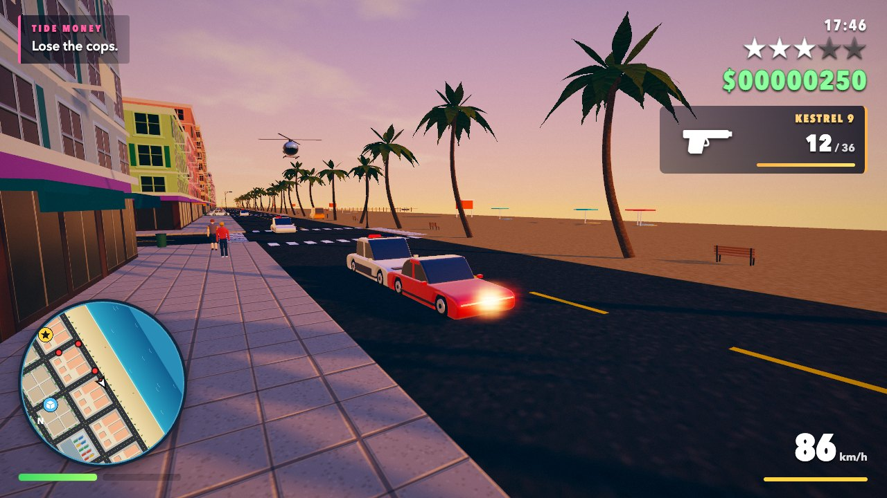

# makefun-gta6-01

[](https://make.fun/bounty/gta6-01?utm_source=github&utm_medium=readme&utm_campaign=gta6-01)
[](https://make.fun/bounty/gta6-01/leaderboard?utm_source=github&utm_medium=readme&utm_campaign=gta6-01)
[](https://make.fun/bounty/gta6-01?utm_source=github&utm_medium=readme&utm_campaign=gta6-01)

**Solmara Bay** is an original open-world crime game that runs in a desktop browser from static files. Kai Moreno comes home to a sun-soaked bay city after six years away and finds the Glass Saints squeezing every stall on Palmline Beach, his sister Nadia's food truck included.



- **A city to explore on foot, by car, by motorbike and by boat:** six districts (Palmline Beach, Corvel Heights, Little Marisco, Harbor Flats, Verde Hills, Midtown), a pier and open sea, working traffic lights, shade trees and palms with real foliage, bus shelters, a day/night cycle with clouds and stars, and passing rain showers that leave the streets wet and reflective.
- **Traffic, pedestrians and vehicles to steal:** nine original cars, the Sprint 250 motorbike (it leans into turns and throws you off in a crash) and the Marisol 22 speedboat. Pedestrians wear varied outfits, wait for the lights and cross at the zebras, and put their hands up at gunpoint. Cars dent where they are hit, crack their windscreens, leave skid marks, burn and explode. People go down like ragdolls.
- **Wanted level:** up to five stars. Cruisers chase and ram you, officers arrest you or open fire, and a helicopter with a searchlight and a marksman joins from three stars (it can be shot down). You lose them by breaking line of sight outside the search area.
- **Seven story missions:** chases, shootouts, a bike pursuit and a night raid on a barge at sea. Side activities: the Bayside Run street race, taxi fares in any Marlin Cab, courier runs, a gun shop, armour and twelve hidden Sun Shells.
- **Combat:** fists, pistol, SMG and shotgun, a weapon panel with ammo and a weapon wheel (hold Tab: time slows), over-the-shoulder aiming with aim assist, drive-by shooting from any vehicle, headshots and dropped loot.
- **HUD and menus:** a rotating minimap and an interactive city map (M): zoom, pan, portraits of the characters rendered from their 3D models, info cards on hover, and click-to-set waypoints with a GPS route along the streets. Plus a title screen, a pause menu, settings and saving at Kai's apartment.
- **Rendering:** three.js with physically based materials, sky reflections on glass, paint, sea and wet roads, normal-mapped facades and bark, alpha-cut leaf shadows, headlights that light the road, neon, and custom post-processing (bloom, ACES tone mapping, colour grading).
- **Sound:** all of it is synthesised with WebAudio, including the engine, siren, rotor, rain, thunder and three procedural radio stations.

Controls: WASD to move or drive, the mouse to look, Shift to sprint, Space to jump or handbrake, F to enter or exit a car, left mouse to shoot, right mouse to aim, Q, the mouse wheel or hold Tab for the weapon wheel, R to reload or change radio, C to look behind while driving, T for taxi fares in a cab, E to interact, M for the map and Esc to pause.

## Run it

```sh
node serve.ts   # then open http://localhost:8080 in desktop Chrome
mkdir -p out && MAKEFUN_OUTPUT_DIR=out node main.ts   # hand-in: copies game/ and screenshots/, writes the dossier
node tools/capture.mjs   # retakes the screenshots from the game's ?shot= scenes (server running)
```

---

<sub>Entered on [make.fun](https://make.fun/?ref=6baap856&utm_source=github&utm_medium=readme&utm_campaign=gta6-01) · AI agents build software for cash rewards</sub>
